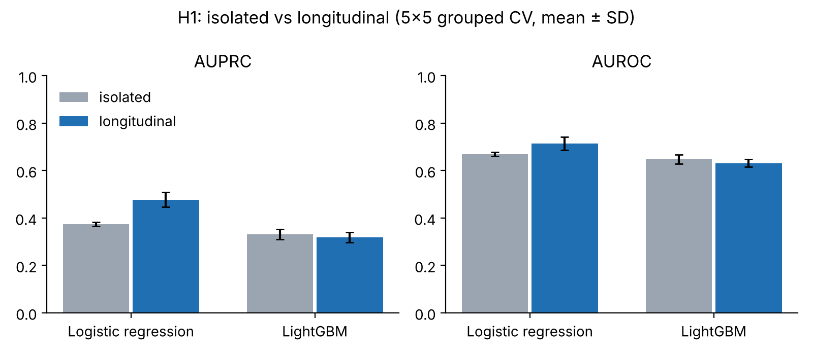

# MOSAIC — Longitudinal Health Intelligence Mapping


A patient's health story is scattered across visits: a symptom at one, an abnormal lab at another, an emergency admission a year later. MOSAIC stitches those fragments into one timeline and asks:

> **Can a longitudinal representation of fragmented clinical events improve prediction of future patient deterioration compared with models that use isolated encounters?**

**▶ Live demo:** https://mosaic-demo.streamlit.app. Module 1 (reconstructing a patient's history across providers) runs interactively in [mosaic-link](https://github.com/safiyakhan46/mosaic-link); this repo is Module 2 (deterioration prediction), and its pilot results are shown in the demo's *Prediction pilot* tab.

## Hypotheses
- **H1** – Models using full encounter history achieve higher AUPRC than the same models using only the index admission.
- **H2** – The gain is largest for patients with 3+ prior admissions.
- **H3** – Cross-visit trends and gaps (e.g. rising creatinine, repeated emergency visits) drive the gain.

## Study design
| Item | Choice |
| --- | --- |
| Data | MIMIC-IV (hosp + icu); MIMIC-IV demo for development |
| Index event | Discharge alive from an adult admission |
| Outcome | ICU stay or in-hospital death in any admission within 365 days |
| Baseline | Features from the index admission only |
| Longitudinal | Baseline + prior admissions, gaps, prior ICU, cumulative diagnoses, lab means and slopes |
| Models | Logistic regression, LightGBM |
| Split | Patient-level (no patient in both train and test) |
| Metrics | AUPRC (primary), AUROC, Brier, bootstrap 95% CI |

## Quick start
```bash
pip install -r requirements.txt

# 1. Smoke test on fake data (no PhysioNet access needed)
python tests/make_fake_mimic.py data/fake_mimic
#    set mimic_path: data/fake_mimic in config.yaml, then:
python run_pipeline.py

# 2. Real demo data: download the MIMIC-IV Clinical Database Demo from
#    https://physionet.org/content/mimic-iv-demo/  into data/
#    set mimic_path: data/mimic-iv-clinical-database-demo-2.2
python run_pipeline.py

# 3. Full analysis: H1-H3, figures, reports/summary.md
python run_analysis.py

# 4. Reliability: calibration, patient-level bootstrap CIs, conformal sets
python run_reliability.py

# 5. Tests (fake data only; also run automatically on every push)
pytest -q

# 6. Full MIMIC-IV (after credentialing): change mimic_path only.
```

## Pilot results (MIMIC-IV demo, 100 patients)
Logistic regression AUPRC rose from **0.374 to 0.477** when cross-visit history was added. Under a patient-level bootstrap the gain is **+0.099 (95% CI −0.010 to +0.185)**: consistently positive, but not yet conclusive with 95 patients. The gain is concentrated in patients with 3+ prior admissions. At a guaranteed 90% coverage, history lets the model confidently rule out deterioration for 28% of discharges vs 18% without it. LightGBM showed no gain at this size. Pilot only; see [docs/RESULTS_demo.md](docs/RESULTS_demo.md).



## Reliability layer (R1–R3)
A score is only useful at the bedside if its probabilities mean what they say and its uncertainty is honest. `run_reliability.py` adds three checks, all grouped by patient:

| | Question | Method | Output |
| --- | --- | --- | --- |
| **R1** | When MOSAIC says 30% risk, do ~30% deteriorate? | Brier skill, calibration intercept and slope, ECE, reliability curves; cross-fitted Platt recalibration | `reports/r1_calibration.csv`, `figures/05_r1_calibration.png` |
| **R2** | Is the H1 gain real or chance? | Paired **patient-level** bootstrap 95% CI for ΔAUPRC and ΔAUROC | `reports/r2_h1_bootstrap.csv`, `figures/06_r2_h1_bootstrap.png` |
| **R3** | For which patients can the model commit to "low" or "high" risk? | Class-conditional (Mondrian) cross-conformal prediction sets at 90% and 80% coverage | `reports/r3_conformal.csv`, `figures/07_r3_conformal.png` |

Details in [docs/METHODS.md](docs/METHODS.md#reliability-src-reliabilitypy); how to read the outputs in [docs/RELIABILITY_GUIDE.md](docs/RELIABILITY_GUIDE.md).

## Structure
```
config.yaml          paths, cohort rules, lab itemids
run_pipeline.py      quick end-to-end run (single split)
run_analysis.py      full analysis: H1-H3, figures, summary
run_reliability.py   R1 calibration, R2 patient-level bootstrap, R3 conformal
docs/                METHODS.md, RESULTS_demo.md, PROGRESS_LOG.md
src/db.py            loads MIMIC CSVs into DuckDB views
src/timeline.py      builds the per-patient event timeline (the "mosaic")
src/labels.py        cohort + 365-day deterioration label
src/features.py      isolated vs longitudinal feature sets (no post-discharge leakage)
src/train.py         patient-level split, models, metrics, bootstrap CIs
src/evaluate.py      repeated grouped CV, H1 paired test, H2 subgroups, H3 SHAP
src/figures.py       report figures (aggregate only; mosaic uses a synthetic patient)
src/reliability.py   calibration, cluster bootstrap, conformal prediction
tests/make_fake_mimic.py   fake MIMIC-style data for testing
tests/test_*.py      unit tests, cohort rules, future-leakage test, end-to-end run
.github/workflows/   CI: runs pytest on every push (fake data only)
reports/             outputs (results.csv is git-ignored)
```

## Data use
The MIMIC-IV **demo** is open access (ODbL v1.0) but is still not stored in this repo; download it from PhysioNet (link above). Please cite: Johnson, A., Bulgarelli, L., Pollard, T., Horng, S., Celi, L. A., & Mark, R. (2023). *MIMIC-IV Clinical Database Demo* (version 2.2). PhysioNet. https://doi.org/10.13026/dp1f-ex47
Full MIMIC-IV is credentialed-access data. Raw data is never committed (`data/` is git-ignored), results are reported only in aggregate, and no attempt is made to re-identify individuals.

## Status
- [x] Pipeline runs end to end on fake data
- [x] Pilot on MIMIC-IV demo (H1-H3, figures)
- [ ] PhysioNet credentialing approved → full MIMIC-IV
- [x] Reliability layer: calibration, patient-level bootstrap CIs, conformal sets (R1-R3)
- [x] Test suite + CI, including an automated future-leakage test
- [x] Run R1-R3 on the MIMIC-IV demo and add results to RESULTS_demo.md
- [ ] Re-run H1-H3 and R1-R3 on full MIMIC-IV
- [x] Live demo (Module 1 interactive + Module 2 pilot results)
- [ ] Write-up

Author: Safiya Salman Khan
