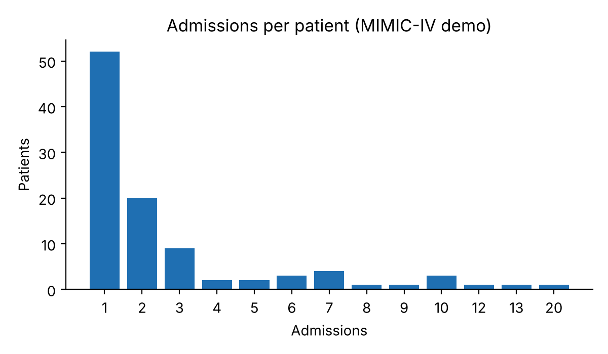
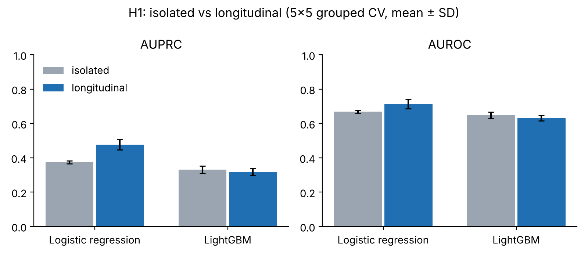
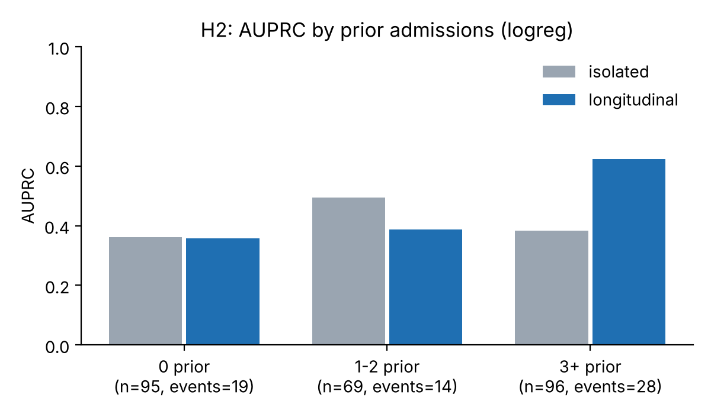
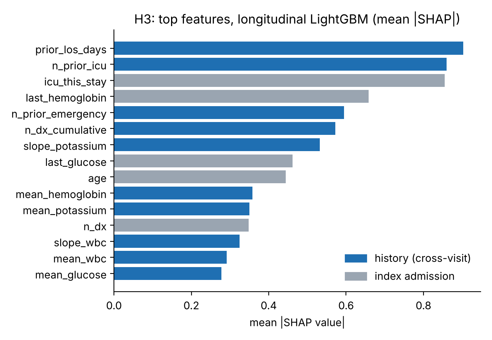
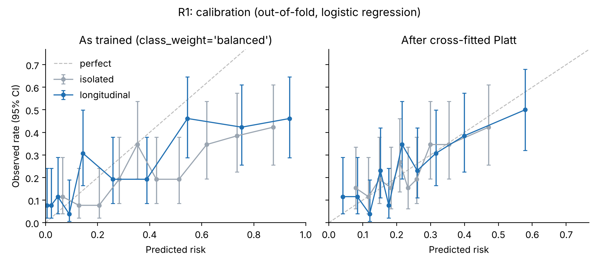
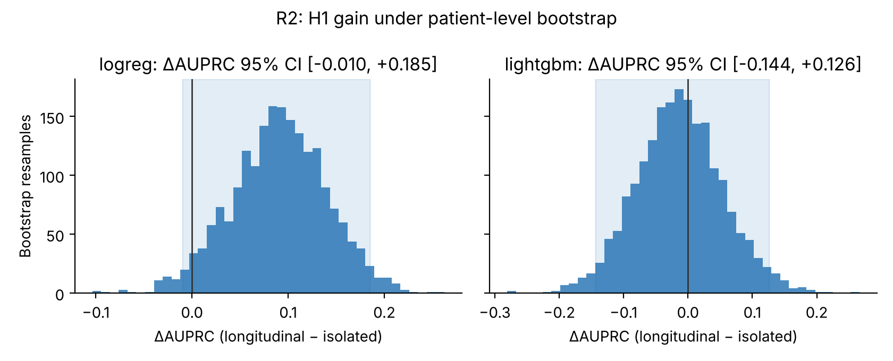
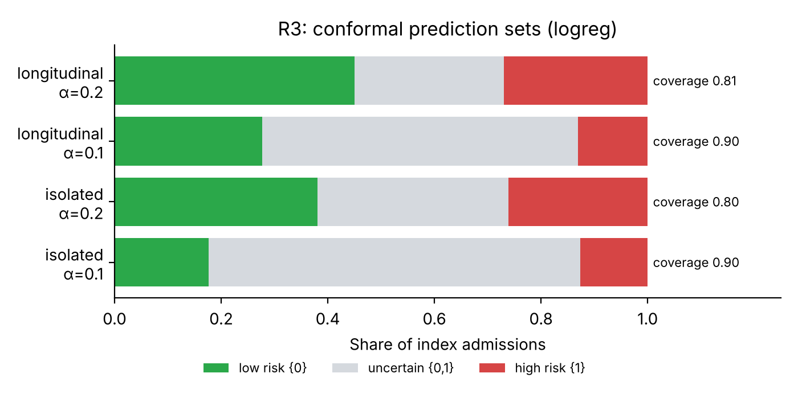
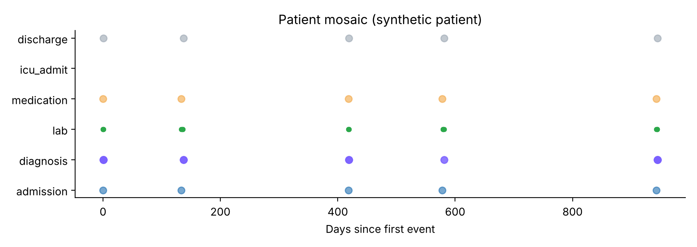

# MOSAIC — Pilot Results on the MIMIC-IV Demo

*Run dates: 21 Nov 2026 (H1–H3), 22 Nov 2026 (R1–R3) · Data: MIMIC-IV Clinical Database Demo v2.2 (100 patients, open access) · Code: `python run_analysis.py`*

> **Pilot only.** 100 patients and 61 outcome events are far too few for conclusions. These results test that the pipeline and analysis plan work end to end, and give a first signal to check on full MIMIC-IV.

## Headline
With **logistic regression**, adding a patient's cross-visit history raised **AUPRC from 0.374 to 0.477 (+0.102)** and AUROC from 0.669 to 0.714, and improved AUPRC in all 5 of 5 repeated CV runs. Under a **patient-level bootstrap** the gain is **+0.099, 95% CI −0.010 to +0.185** (positive in 96% of resamples): a consistent positive signal that is **not yet statistically conclusive with 95 patients**. **LightGBM showed no gain** (−0.012), most likely because 35 features on 260 rows lets a tree ensemble overfit.

With history, the recalibrated model is the only one clearly better than the base rate (Brier skill 0.10 vs 0.04 isolated). At a guaranteed 90% coverage it can confidently classify **41% of discharges instead of 30%**.

## Cohort
| Index admissions | Patients | Outcome events | Positive rate |
| ---: | ---: | ---: | ---: |
| 260 | 95 | 61 | 23.5% |

Index admission = adult discharged alive. Outcome = ICU stay or in-hospital death in any admission within 365 days of discharge.

## H1 — Does history improve prediction?
5 × 5-fold cross-validation, grouped by patient (no patient in both train and test).

| Features | Model | AUPRC (mean ± SD) | AUROC (mean ± SD) |
| --- | --- | --- | --- |
| Isolated | Logistic regression | 0.374 ± 0.009 | 0.669 ± 0.009 |
| Longitudinal | Logistic regression | **0.477 ± 0.031** | **0.714 ± 0.028** |
| Isolated | LightGBM | 0.331 ± 0.022 | 0.648 ± 0.020 |
| Longitudinal | LightGBM | 0.319 ± 0.021 | 0.631 ± 0.016 |

Paired difference (longitudinal − isolated), logistic regression: ΔAUPRC +0.102 (range +0.066 to +0.133), ΔAUROC +0.045.

**Reading:** supports H1 for the linear model; not for LightGBM at this sample size. SDs reflect split-to-split variation only, not sampling uncertainty across patients, so they understate true uncertainty.

## H2 — Is the gain largest for patients with long histories?
| Prior admissions | Index admissions | Events | AUPRC isolated | AUPRC longitudinal |
| --- | ---: | ---: | ---: | ---: |
| 0 | 95 | 19 | 0.362 | 0.358 |
| 1–2 | 69 | 14 | 0.494 | 0.387 |
| 3+ | 96 | 28 | 0.383 | **0.624** |

*(logistic regression)*

**Reading:** consistent with H2. The large gain sits in the 3+ group. The 0-prior group shows no change, which is the expected sanity check, since these patients have no history to add. The 1–2 group drops, but with 14 events this is unstable and must be re-tested on full data.

## H3 — Which features drive it?
Top-15 mean |SHAP| from the longitudinal LightGBM: **the top two features are both cross-visit** (total prior length of stay, number of prior ICU stays), followed by ICU in the index stay. 9 of the top 15 are history features, including prior emergency admissions, cumulative diagnoses and the potassium trend.

**Reading:** consistent with H3: utilisation history (prior ICU, prior stays, emergency visits) carries more signal than lab trends at this scale. SHAP here is descriptive (fitted on all rows) and comes from the model that did not improve overall, so treat it as hypothesis-generating.

## R1 — Are the predicted risks trustworthy? (calibration)
Out-of-fold scores averaged over the 5 CV repeats; recalibration is cross-fitted Platt scaling grouped by patient.

| Features | Model | Stage | Mean predicted | Observed | Cal. intercept | Cal. slope | Brier skill |
| --- | --- | --- | ---: | ---: | ---: | ---: | ---: |
| Isolated | Logistic regression | raw | 0.420 | 0.235 | −1.15 | 0.45 | −0.24 |
| Isolated | Logistic regression | recalibrated | 0.236 | 0.235 | −0.01 | 0.73 | 0.04 |
| Longitudinal | Logistic regression | raw | 0.319 | 0.235 | −0.77 | 0.37 | −0.09 |
| Longitudinal | Logistic regression | recalibrated | 0.235 | 0.235 | 0.00 | 0.81 | **0.10** |
| Longitudinal | LightGBM | raw | 0.156 | 0.235 | +0.78 | 0.24 | −0.11 |
| Longitudinal | LightGBM | recalibrated | 0.236 | 0.235 | −0.01 | 0.80 | 0.03 |

**Reading:** the raw logistic models **over-predict risk** (mean predicted 0.42 vs 0.235 observed), as expected from `class_weight="balanced"`. Raw, every model is worse than predicting the base rate (negative Brier skill). Recalibration fixes the average (intercept ≈ 0), but slopes stay below 1 (0.73–0.85): the predictions are still too spread out, a sign of overfitting at this sample size. Ranking metrics (H1) are unaffected. **Probabilities must be recalibrated before they are shown to anyone.**

## R2 — How certain is the H1 gain? (patient-level bootstrap)
2,000 paired resamples of patients (all of a patient's admissions move together).

| Model | Metric | Isolated | Longitudinal | Δ | 95% CI | Resamples with Δ > 0 |
| --- | --- | ---: | ---: | ---: | --- | ---: |
| Logistic regression | AUPRC | 0.377 | 0.475 | **+0.099** | −0.010 to +0.185 | 96% |
| Logistic regression | AUROC | 0.676 | 0.728 | +0.052 | −0.019 to +0.132 | 92% |
| LightGBM | AUPRC | 0.344 | 0.331 | −0.013 | −0.144 to +0.126 | 42% |
| LightGBM | AUROC | 0.663 | 0.654 | −0.008 | −0.091 to +0.063 | 42% |

**Reading:** the point estimate matches the CV result, but the honest interval is about three times wider than the CV standard deviation (±0.03) suggested, and its lower end just crosses zero. H1 is **directionally supported for the linear model but not established**. This is the clearest quantitative argument for running the study on full MIMIC-IV, where the interval should narrow substantially.

## R3 — When can the model commit? (conformal prediction)
Class-conditional cross-conformal sets, logistic regression; coverage is checked separately for patients who did and did not deteriorate.

| Features | Target coverage | Achieved (all / events) | Confident "low" | Uncertain | Confident "high" | NPV of "low" | PPV of "high" |
| --- | ---: | --- | ---: | ---: | ---: | ---: | ---: |
| Isolated | 90% | 0.90 / 0.90 | 18% | 70% | 13% | 0.87 | 0.42 |
| Longitudinal | 90% | 0.90 / 0.90 | **28%** | **59%** | 13% | **0.92** | 0.38 |
| Isolated | 80% | 0.80 / 0.80 | 38% | 36% | 26% | 0.88 | 0.40 |
| Longitudinal | 80% | 0.81 / 0.82 | **45%** | **28%** | 27% | 0.91 | 0.44 |

**Reading:** coverage hits its target for both classes. At the same guaranteed error rate, **history lets the model safely rule out deterioration for more patients** (28% vs 18% confidently low at 90% coverage, with NPV 0.92 vs 0.87). "High risk" calls are only moderately precise (PPV about 0.4, against a 0.235 base rate), so the practical value at this scale is ruling patients *out*, not flagging them. This restates H1 in clinical terms and should be re-tested on full data.

## The "mosaic" view
One synthetic patient (generated by `tests/make_fake_mimic.py`, not a real record) with every fragment on one time axis:

## Limitations
1. Tiny sample (95 patients, 61 events); the demo is not a random sample of MIMIC-IV, and every demo patient has an ICU stay, so the outcome is enriched.
2. Patients who left the health system or died outside hospital within 365 days count as negatives (no censoring).
3. Diagnoses have no timestamps in MIMIC-IV and are anchored at discharge; no diagnosis from admission k is used before k's discharge.
4. Single-centre US data; results may not transfer to Saudi or other settings.
5. Conformal coverage is approximate: out-of-fold scores come from models trained on overlapping data, so exchangeability holds only approximately (coverage is verified empirically above).
6. R1–R3 use out-of-fold scores averaged over 5 CV repeats, which is a mild ensemble of the per-repeat models.

## Next steps on full MIMIC-IV
- Re-run unchanged (only `mimic_path` changes); report H1 with the patient-level bootstrap CI as the primary uncertainty estimate.
- Tune LightGBM regularisation; add a sequence model (GRU) only if time allows.
- Check whether recalibrated slopes approach 1 with more data; otherwise add regularisation.
- Censoring-aware sensitivity analysis (exclude patients with < 365 days of follow-up).
